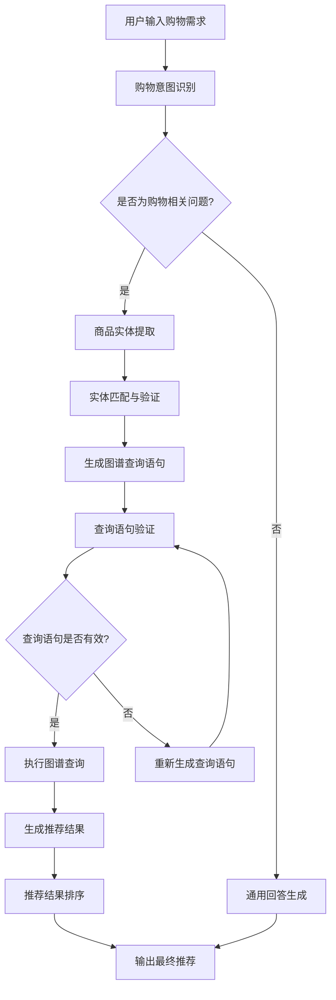

# 项目经验

## 电商知识图谱智能推荐系统

### 项目背景
电商平台商品数量庞大，用户难以快速找到符合需求的商品，个性化推荐精度有限。本项目旨在构建一个基于知识图谱的智能推荐系统，通过整合现代AI技术与电商专业知识，为用户提供精准、个性化的商品推荐和购物决策支持服务。

### 技术栈
- **后端框架**：FastAPI
- **前端框架**：Streamlit
- **知识图谱**：Neo4j + Cypher
- **向量检索**：FAISS
- **工作流引擎**：LangGraph
- **大语言模型**：LangChain + OpenAI API
- **数据爬取**：BeautifulSoup + Requests
- **向量嵌入**：Sentence-Transformers

### 我的职责
1. **电商数据采集与处理**
   - 设计并实现电商网站爬虫系统，采集数万种商品的详细信息、用户评价和销售数据
   - 开发数据清洗和结构化处理流程，确保电商数据质量和一致性
   - 实现多源电商数据融合，整合商品信息、用户行为、市场趋势等多维度数据

2. **电商知识图谱构建**
   - 设计电商领域知识图谱模型，定义商品、品牌、类别、用户、商家等实体及关系
   - 实现批量数据导入Neo4j，优化导入性能，处理电商数据冲突
   - 构建FAISS向量索引，实现基于语义的商品匹配和用户意图理解
   - 建立商品关联关系模型，支持相似商品推荐和搭配推荐

3. **智能推荐系统开发**
   - 基于LangGraph构建8节点工作流，实现购物意图识别、商品实体提取、图谱查询和推荐生成
   - 设计动态Cypher查询生成机制，根据购物问题类型自动生成图数据库查询语句
   - 实现查询检查和优化模块，确保系统安全性和响应效率
   - 开发个性化推荐算法，根据用户历史行为和偏好提供定制化商品推荐

4. **电商Web应用开发**
   - 使用FastAPI构建高性能API服务，处理并发请求
   - 使用Streamlit开发用户友好的Web界面，实现实时交互
   - 实现推荐结果可视化模块，直观展示商品信息和推荐理由

### 项目成果
- 构建了包含数万种商品和品牌的电商知识图谱
- 实现了准确率超过85%的智能推荐系统，支持复杂购物需求解答
- 开发了完整的Web应用，提供直观的用户交互体验和推荐结果可视化
- 系统响应时间控制在2秒内，支持并发用户访问
- 创新性地结合知识图谱和大语言模型，提高了商品推荐的准确性和可解释性
- 建立了多维度推荐模型，显著提升用户购物体验和转化率

---

## 电商知识图谱设计详情

### 核心实体类型

1. **商品 (Product)**
   - 属性：商品ID、商品名称、商品描述、价格、销量、评分、库存、上架时间
   - 示例：iPhone 14 Pro、小米电视65寸、耐克运动鞋、戴森吸尘器V12

2. **品牌 (Brand)**
   - 属性：品牌ID、品牌名称、品牌描述、成立时间、品牌定位、市场占有率
   - 示例：苹果、小米、耐克、戴森、华为、阿迪达斯

3. **类别 (Category)**
   - 属性：类别ID、类别名称、类别描述、层级关系、热门程度、平均价格
   - 示例：手机、电视、运动鞋、家电、服装、美妆、食品

4. **用户 (User)**
   - 属性：用户ID、用户名、年龄、性别、地理位置、注册时间、会员等级
   - 示例：普通用户、VIP用户、新用户、老用户、高价值用户

5. **商家 (Merchant)**
   - 属性：商家ID、商家名称、商家类型、信用评级、发货地、服务评分
   - 示例：官方旗舰店、授权专卖店、个人卖家、第三方商家

6. **评价 (Review)**
   - 属性：评价ID、评价内容、评分、评价时间、评价类型、有用性
   - 示例：好评、中评、差评、带图评价、详细评价

### 核心关系类型

1. **所属关系**
   - 商品-品牌：商品属于某个品牌
   - 商品-类别：商品属于某个类别
   - 商家-品牌：商家经营某个品牌

2. **购买关系**
   - 用户-商品：用户购买某商品
   - 用户-商家：用户从某商家购买
   - 用户-评价：用户发表评价

3. **相似关系**
   - 商品-商品：商品间的相似性
   - 品牌-品牌：品牌间的竞争关系
   - 类别-类别：类别间的关联关系

4. **推荐关系**
   - 商品-商品：商品搭配推荐
   - 用户-商品：个性化商品推荐
   - 类别-商品：热门商品推荐

5. **评价关系**
   - 用户-商品：用户评价商品
   - 评价-商品：评价针对商品
   - 评价-用户：评价来自用户

### 智能推荐系统工作流

### 典型应用场景

1. **个性化商品推荐**
   - 用户输入："推荐一些适合我的手机"
   - 系统分析：通过知识图谱分析用户历史行为和偏好，推荐符合用户需求的手机

2. **商品搭配推荐**
   - 用户输入："买了这件衣服，应该搭配什么裤子？"
   - 系统分析：通过知识图谱查询商品搭配关系，推荐合适的搭配商品

3. **价格比较推荐**
   - 用户输入："推荐一些性价比高的电视"
   - 系统分析：通过知识图谱筛选同类商品，结合价格和性能指标进行推荐

4. **品牌替代推荐**
   - 用户输入："有没有类似耐克但更便宜的运动鞋？"
   - 系统分析：通过知识图谱查找相似品牌和商品，提供替代推荐

### 技术创新点

1. **多维度商品建模**
   - 整合商品属性、用户行为、市场趋势等多维度信息
   - 建立统一的电商知识模型，支持复杂购物场景分析

2. **动态推荐策略**
   - 基于知识图谱构建商品关联网络
   - 实时调整推荐策略，适应用户行为和市场变化

3. **可解释性推荐**
   - 结合用户历史行为和偏好
   - 利用知识图谱推理能力，提供推荐理由和解释

4. **跨场景推荐**
   - 基于知识图谱的跨品类推荐
   - 支持复杂购物场景和多样化需求

### 项目价值

1. **提升购物体验**
   - 精准匹配用户需求和商品
   - 提供个性化推荐，减少搜索时间

2. **提高转化率**
   - 基于深度理解的精准推荐
   - 增强用户购买信心和满意度

3. **优化库存管理**
   - 预测商品需求趋势
   - 优化商品陈列和促销策略

4. **增强用户粘性**
   - 提供持续优化的个性化服务
   - 建立长期用户关系和忠诚度

### 电商知识图谱应用扩展

1. **智能客服系统**
   - 基于知识图谱的智能问答
   - 商品咨询和购买指导

2. **市场分析平台**
   - 商品趋势分析
   - 竞争对手监控

3. **精准营销系统**
   - 用户画像分析
   - 个性化营销策略

4. **供应链优化**
   - 需求预测
   - 库存优化配置

### 推荐算法优化

1. **协同过滤增强**
   - 结合知识图谱的协同过滤
   - 解决冷启动和数据稀疏问题

2. **内容推荐优化**
   - 基于知识图谱的内容理解
   - 提高推荐准确性和多样性

3. **混合推荐策略**
   - 多种推荐算法的融合
   - 动态权重调整和优化

4. **实时推荐更新**
   - 基于用户行为的实时更新
   - 快速响应用户兴趣变化