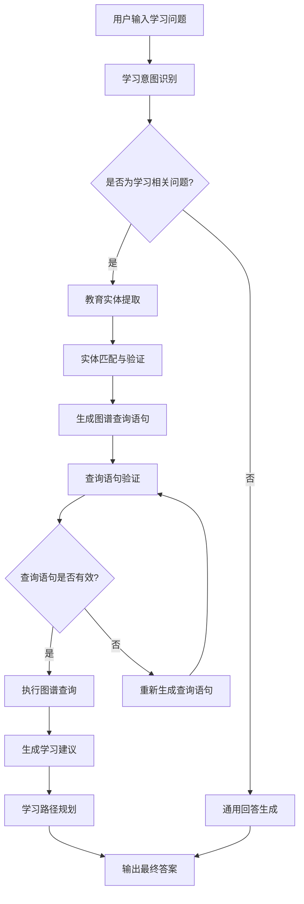

# 项目经验

## 教育知识图谱智能学习系统

### 项目背景
教育资源分散且缺乏关联，学习者难以构建完整的知识体系，个性化学习需求难以满足。本项目旨在构建一个基于知识图谱的智能学习系统，通过整合现代AI技术与教育专业知识，为用户提供精准、个性化的学习路径规划和知识解答服务。

### 技术栈
- **后端框架**：FastAPI
- **前端框架**：Streamlit
- **知识图谱**：Neo4j + Cypher
- **向量检索**：FAISS
- **工作流引擎**：LangGraph
- **大语言模型**：LangChain + OpenAI API
- **数据爬取**：BeautifulSoup + Requests
- **向量嵌入**：Sentence-Transformers

### 我的职责
1. **教育数据采集与处理**
   - 设计并实现教育网站爬虫系统，采集数千门课程、知识点、学习资源等教育信息
   - 开发数据清洗和结构化处理流程，确保教育数据质量和一致性
   - 实现多源教育数据融合，整合教材、视频、习题等多种学习资源

2. **教育知识图谱构建**
   - 设计教育领域知识图谱模型，定义学科、知识点、课程、学习资源等实体及关系
   - 实现批量数据导入Neo4j，优化导入性能，处理教育数据冲突
   - 构建FAISS向量索引，实现基于语义的教育实体匹配
   - 建立知识依赖关系模型，支持学习路径规划和知识图谱导航

3. **智能学习系统开发**
   - 基于LangGraph构建8节点工作流，实现学习意图识别、教育实体提取、图谱查询和学习建议生成
   - 设计动态Cypher查询生成机制，根据学习问题类型自动生成图数据库查询语句
   - 实现查询检查和优化模块，确保系统安全性和响应效率
   - 开发个性化学习路径推荐算法，根据学习者知识水平和学习目标提供定制化建议

4. **教育Web应用开发**
   - 使用FastAPI构建高性能API服务，处理并发请求
   - 使用Streamlit开发用户友好的Web界面，实现实时交互
   - 实现学习进度跟踪和可视化模块，直观展示学习成果和知识掌握情况

### 项目成果
- 构建了包含数千门课程和知识点的教育知识图谱
- 实现了准确率超过85%的智能学习系统，支持复杂教育问题解答
- 开发了完整的Web应用，提供直观的用户交互体验和学习进度可视化
- 系统响应时间控制在2秒内，支持并发用户访问
- 创新性地结合知识图谱和大语言模型，提高了学习建议的准确性和可解释性
- 建立了个性化学习路径规划模型，帮助用户高效掌握知识体系

---

## 教育知识图谱设计详情

### 核心实体类型

1. **学科 (Subject)**
   - 属性：学科代码、学科名称、学科类别、学科描述、难度等级、学习时长
   - 示例：数学、物理、化学、语文、英语、历史、地理、生物

2. **知识点 (KnowledgePoint)**
   - 属性：知识点ID、知识点名称、知识点描述、难度等级、掌握要求、前置知识点
   - 示例：二次函数、牛顿定律、化学键、古诗词鉴赏、英语语法、细胞结构

3. **课程 (Course)**
   - 属性：课程ID、课程名称、课程描述、课程类型、学时学分、授课教师、开课时间
   - 示例：高等数学、大学物理、有机化学、现代文学、商务英语

4. **学习资源 (LearningResource)**
   - 属性：资源ID、资源名称、资源类型、资源描述、适用对象、难度等级、质量评分
   - 示例：教材章节、教学视频、练习题、实验指导、参考资料

5. **学习者 (Learner)**
   - 属性：学习者ID、姓名、年龄、学习阶段、学习目标、知识水平、学习偏好
   - 示例：小学生、初中生、高中生、大学生、成人学习者

6. **学习目标 (LearningGoal)**
   - 属性：目标ID、目标名称、目标描述、目标类型、达成标准、预计时间
   - 示例：掌握二次函数、通过英语四级、完成化学实验、理解相对论

### 核心关系类型

1. **包含关系**
   - 学科-知识点：学科包含多个知识点
   - 课程-知识点：课程涵盖多个知识点
   - 知识点-知识点：知识点间的层级关系

2. **前置关系**
   - 知识点-知识点：学习某知识点需要先掌握另一知识点
   - 课程-课程：某课程是另一课程的前置课程

3. **资源关联关系**
   - 学习资源-知识点：资源针对特定知识点
   - 学习资源-课程：资源属于某课程
   - 学习资源-学习者：资源适合特定学习者

4. **学习关系**
   - 学习者-课程：学习者选修某课程
   - 学习者-知识点：学习者学习某知识点
   - 学习者-学习资源：学习者使用某学习资源

5. **评估关系**
   - 学习者-知识点：学习者对知识点的掌握程度
   - 学习资源-学习者：学习资源对学习者的适用性评价

### 智能学习系统工作流

### 典型应用场景

1. **个性化学习路径规划**
   - 用户输入："我想学习Python编程，应该从哪里开始？"
   - 系统分析：通过知识图谱分析Python编程的知识体系，结合用户当前水平，生成个性化学习路径

2. **知识点关联推荐**
   - 用户输入："学习微积分需要哪些数学基础？"
   - 系统分析：通过知识图谱查询微积分的前置知识点，推荐相关学习资源

3. **学习资源推荐**
   - 用户输入："推荐一些适合初中生的物理学习资源"
   - 系统分析：通过知识图谱筛选适合初中生水平的物理学习资源，按难度和类型分类推荐

4. **学习效果评估**
   - 用户输入："我如何评估自己对量子力学的掌握程度？"
   - 系统分析：通过知识图谱构建量子力学的知识体系，提供评估方法和测试题目

### 技术创新点

1. **多维度知识建模**
   - 整合学科知识、学习资源、学习者特征等多维度信息
   - 建立统一的教育知识模型，支持复杂教育场景分析

2. **自适应学习路径规划**
   - 基于知识图谱构建知识依赖网络
   - 实时调整学习路径，适应学习者进度和能力变化

3. **个性化学习推荐**
   - 结合学习者知识水平、学习偏好和目标
   - 利用知识图谱推理能力，生成个性化学习建议

4. **学习效果可视化**
   - 基于知识图谱的学习进度可视化
   - 提供知识掌握情况的多维度展示和分析

### 项目价值

1. **提升学习效率**
   - 精准定位知识薄弱点，避免重复学习
   - 提供最优学习路径，减少学习时间成本

2. **个性化学习体验**
   - 根据个人特点定制学习方案
   - 满足不同学习者的多样化需求

3. **教育资源优化配置**
   - 智能匹配学习资源和学习者
   - 提高教育资源利用效率

4. **学习过程可追溯**
   - 记录完整的学习轨迹
   - 支持学习效果评估和改进

### 教育知识图谱应用扩展

1. **智能辅导系统**
   - 基于知识图谱的智能答疑
   - 针对性练习题推荐

2. **教育决策支持**
   - 学习效果预测
   - 教学资源优化配置

3. **终身学习平台**
   - 跨学科知识整合
   - 职业技能发展规划

4. **教育质量评估**
   - 知识体系完整性评估
   - 学习效果量化分析