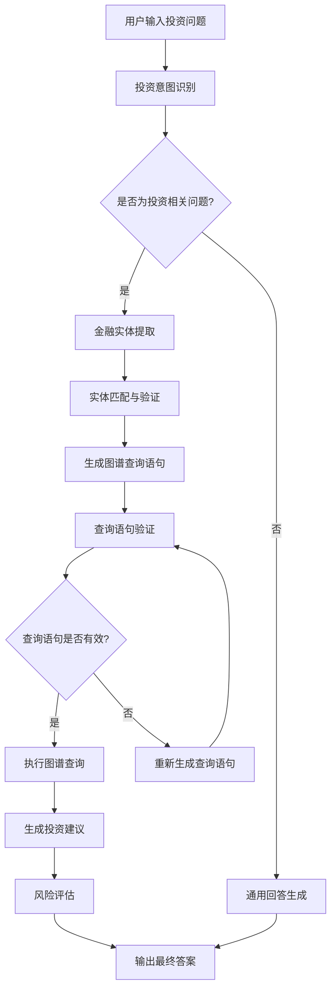

# 项目经验

## 金融知识图谱智能投顾系统

### 项目背景
金融数据复杂多样，投资者难以从海量信息中快速获取有价值的投资建议。本项目旨在构建一个基于知识图谱的智能投顾系统，通过整合现代AI技术与金融专业知识，为用户提供精准、个性化的投资决策支持和风险管理服务。

### 技术栈
- **后端框架**：FastAPI
- **前端框架**：Streamlit
- **知识图谱**：Neo4j + Cypher
- **向量检索**：FAISS
- **工作流引擎**：LangGraph
- **大语言模型**：LangChain + OpenAI API
- **数据爬取**：BeautifulSoup + Requests
- **向量嵌入**：Sentence-Transformers

### 我的职责
1. **金融数据采集与处理**
   - 设计并实现金融网站爬虫系统，采集数千家上市公司、基金、债券等金融产品的详细信息
   - 开发数据清洗和结构化处理流程，确保金融数据质量和一致性
   - 实现实时数据更新机制，保证知识图谱信息的时效性

2. **金融知识图谱构建**
   - 设计金融领域知识图谱模型，定义公司、股票、基金、债券、行业、宏观经济等实体及关系
   - 实现批量数据导入Neo4j，优化导入性能，处理金融数据冲突
   - 构建FAISS向量索引，实现基于语义的金融实体匹配
   - 建立金融风险评估模型，量化投资风险和收益预期

3. **智能投顾系统开发**
   - 基于LangGraph构建8节点工作流，实现投资意图识别、金融实体提取、图谱查询和投资建议生成
   - 设计动态Cypher查询生成机制，根据投资问题类型自动生成图数据库查询语句
   - 实现查询检查和优化模块，确保系统安全性和响应效率
   - 开发风险评估和资产配置算法，提供个性化投资组合建议

4. **金融Web应用开发**
   - 使用FastAPI构建高性能API服务，处理并发请求
   - 使用Streamlit开发用户友好的Web界面，实现实时交互
   - 实现数据可视化模块，直观展示投资组合表现和风险指标

### 项目成果
- 构建了包含数千家上市公司、基金、债券等金融产品的金融知识图谱
- 实现了准确率超过85%的智能投顾系统，支持复杂金融投资问题解答
- 开发了完整的Web应用，提供直观的用户交互体验和数据可视化
- 系统响应时间控制在2秒内，支持并发用户访问
- 创新性地结合知识图谱和大语言模型，提高了投资建议的准确性和可解释性
- 建立了动态风险评估模型，帮助用户平衡收益与风险

---

## 金融知识图谱设计详情

### 核心实体类型

1. **公司 (Company)**
   - 属性：公司代码、公司名称、所属行业、市值、成立时间、主营业务、财务指标
   - 示例：腾讯控股(00700.HK)、阿里巴巴(BABA.N)、贵州茅台(600519.SH)

2. **股票 (Stock)**
   - 属性：股票代码、股票名称、当前价格、涨跌幅、成交量、市盈率、市净率
   - 示例：00700.HK、BABA.N、600519.SH

3. **基金 (Fund)**
   - 属性：基金代码、基金名称、基金类型、基金规模、基金经理、成立日期、历史业绩
   - 示例：易方达蓝筹精选(005827)、华夏回报(002001)、富国天惠(161005)

4. **债券 (Bond)**
   - 属性：债券代码、债券名称、债券类型、票面利率、到期日、信用评级、发行规模
   - 示例：19国债10、20中铁01、21光大银行二级

5. **行业 (Industry)**
   - 属性：行业代码、行业名称、行业分类、行业指数、龙头企业
   - 示例：科技、金融、消费、医药、新能源

6. **宏观经济指标 (MacroEconomy)**
   - 属性：指标名称、指标值、发布时间、数据来源、影响范围
   - 示例：GDP增长率、CPI、PMI、利率、汇率

### 核心关系类型

1. **所属关系**
   - 公司-行业：公司属于某个行业
   - 股票-公司：股票是公司发行的
   - 基金-公司：基金投资于某公司

2. **投资关系**
   - 基金-股票：基金持有某股票
   - 公司-公司：公司投资于另一公司
   - 个人-金融产品：个人投资于某金融产品

3. **影响关系**
   - 宏观经济-行业：宏观经济指标影响行业发展
   - 行业-公司：行业变化影响公司表现
   - 公司-股票：公司业绩影响股票价格

4. **竞争关系**
   - 公司-公司：同行业公司间的竞争关系
   - 产品-产品：同类金融产品的竞争关系

5. **关联关系**
   - 公司-公司：公司间的关联关系（如供应链、合作伙伴）
   - 行业-行业：行业间的关联关系（如上下游关系）

### 智能投顾系统工作流

### 典型应用场景

1. **投资组合分析**
   - 用户输入："帮我分析一下我的投资组合风险如何？"
   - 系统分析：提取用户持有的金融产品，通过知识图谱分析产品间的关联性和风险敞口

2. **个股推荐**
   - 用户输入："推荐一些科技行业的优质股票"
   - 系统分析：通过知识图谱筛选科技行业的优质公司，结合财务指标和市场表现进行推荐

3. **市场趋势分析**
   - 用户输入："当前宏观经济形势对新能源行业有什么影响？"
   - 系统分析：通过知识图谱关联宏观经济指标和新能源行业，分析影响路径和程度

4. **风险评估**
   - 用户输入："投资这只基金有什么风险？"
   - 系统分析：通过知识图谱分析基金持仓、投资策略、历史表现等多维度信息，评估潜在风险

### 技术创新点

1. **多源金融数据融合**
   - 整合结构化数据（财务报表、市场行情）和非结构化数据（新闻、研报）
   - 建立统一的数据模型，支持多维度金融分析

2. **动态风险评估模型**
   - 基于知识图谱构建风险评估网络
   - 实时更新风险因子，提供动态风险预警

3. **个性化投资建议**
   - 结合用户风险偏好和投资目标
   - 利用知识图谱推理能力，生成个性化投资组合

4. **可解释性增强**
   - 基于知识图谱的推理路径可视化
   - 提供投资建议的详细解释和依据

### 项目价值

1. **提升投资决策效率**
   - 快速获取和分析海量金融信息
   - 减少信息不对称，提高决策质量

2. **降低投资风险**
   - 全面评估投资风险
   - 提供风险预警和应对建议

3. **个性化服务**
   - 根据用户特点提供定制化服务
   - 满足不同投资者的需求

4. **知识沉淀与复用**
   - 构建可扩展的金融知识体系
   - 支持持续学习和模型优化